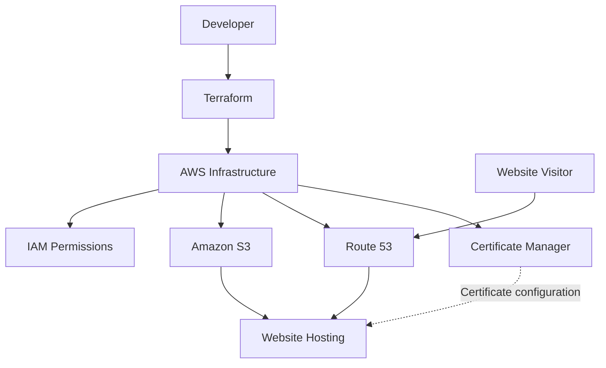

# AWS Infrastructure Automation with Terraform

**An Infrastructure as Code project using Terraform and AWS to provision and manage cloud resources for a static website.**

## Overview

This project explores the automation of cloud infrastructure on Amazon Web Services (AWS) using Terraform.

The goal is to define infrastructure through reusable configuration files, simplify resource management, and apply version-control and security best practices.

## Technologies

- **Cloud provider:** Amazon Web Services (AWS)
- **Infrastructure as Code:** Terraform
- **Object storage and website hosting:** Amazon S3
- **DNS management:** Amazon Route 53
- **Certificate management:** AWS Certificate Manager (ACM)
- **Access control:** AWS IAM
- **Version control:** Git and GitHub

## Project Structure

```text
ProjetFederateur/
├── frontend/
│   └── index.html
├── infrastructure/
│   ├── acm.tf
│   ├── backend.tf
│   ├── iam.tf
│   ├── locals.tf
│   ├── main.tf
│   ├── outputs.tf
│   ├── provider.tf
│   ├── route53.tf
│   ├── variables.tf
│   ├── versions.tf
│   └── .terraform.lock.hcl
├── .gitignore
└── README.md
```

## Key Features

- Infrastructure defined and managed through Terraform.
- AWS resource configuration organized into separate files.
- IAM configuration for access management.
- S3 resources for static website hosting.
- DNS configuration using Route 53.
- Certificate configuration using AWS Certificate Manager.
- Git-based version control.
- Local Terraform state and variable files excluded from the public repository.

## Architecture Overview




Terraform manages the infrastructure configuration and provisions the AWS resources defined in the project.

The intended website flow is:

1. A user requests the website through a browser.
2. DNS resolves the configured domain through Route 53.
3. The website files are served from the configured hosting infrastructure.
4. HTTPS is provided if the certificate is connected to a compatible service in the deployed architecture.

The exact request flow depends on the AWS resources configured and deployed.

## Prerequisites

Before deploying the infrastructure, you need:

- An AWS account.
- Terraform installed.
- AWS CLI installed and configured with appropriate permissions.
- A domain name and access to its DNS configuration, if using a custom domain.
- The required AWS resources and backend configuration.

## Getting Started

Clone the repository:

```bash
git clone https://github.com/Feryel10/ProjetFederateur.git
cd ProjetFederateur/infrastructure
```

Initialize Terraform:

```bash
terraform init
```

Review the configuration:

```bash
terraform fmt -check
terraform validate
terraform plan
```

Review the execution plan carefully before applying any changes.

To deploy, run `terraform apply` only after verifying the configuration, AWS credentials, backend settings, and expected costs.

**Important:** Do not commit AWS credentials, Terraform state files, or files containing sensitive values. Configure the backend and required variables for your own environment before deployment.

## Security Practices

- Exclude `terraform.tfstate` and related state files from version control.
- Keep `terraform.tfvars` and credentials out of the repository.
- Use IAM permissions appropriate to the deployment.
- Review Terraform plans before applying infrastructure changes.
- Protect the remote Terraform state and configure access to the backend securely.

## Learning Outcomes

This project provides practical experience with:

- Infrastructure as Code principles.
- AWS infrastructure configuration.
- Terraform project organization and workflow.
- Cloud resource access management.
- DNS and certificate configuration concepts.
- Git and GitHub version control.

## Author

**Feriel Aidoudi**  
Big Data & Data Analytics Student | Aspiring Data Engineer

[Connect on LinkedIn](https://linkedin.com/in/feriel-aidoudi-16a142322/)

---

*This repository is a learning project. Verify the current AWS configuration and deployment status before using it in production.*
